# 1401 Campus

**1401 Coffee baristalarının reçeteleri ve standartları öğrendiği, sınava girdiği, rozet kazandığı eğitim uygulaması.** Kahve Operasyonu ekibi aynı sistemi bilgisayardan yönetir, Yönetim Kurulu gidişatı izler.

[Canlı](https://1401-campus.web.app) · [Kurulum yönergesi](https://1401-campus.web.app/indir/) · [Demo](https://playbook-demo-1401.web.app) · [Günlük kullanım: CANLI.md](CANLI.md) · Sürüm 1.1

<p align="center">
  
  &nbsp;
  
</p>

---

## Ne işe yarar

| Kim | Nerede | Ne yapar |
|---|---|---|
| **Barista** | Mağaza telefonu | Reçeteye bakar, ders okur, sınava girer, rozet ve başarım kazanır, bülteni okur. |
| **Mağaza / vardiya müdürü** | Mağaza telefonu | Ekibinin ilerlemesini görür, görev atar, Kahve Operasyonu'na talep açar (arıza, malzeme, personel). |
| **Kahve Operasyonu** | Web paneli | Baristaları ve mağazaları yönetir; ders, reçete ve soru yazar; görev atar; bülten yayınlar; talepleri yanıtlar. |
| **Kahve Operasyon Direktörü** | Web paneli | Önerileri onaylar, ekibi ve yetkileri yönetir, müfredatı günceller. |
| **Yönetim Kurulu** | Web paneli (salt okunur) | Mağaza karnelerini, süren işleri ve raporları izler; Kahve Operasyonu'na soru sorar. |

**Sayılarla:** 4 eğitim yolu · 14 modül · 96 ders · 67 reçete · 1.334 soruluk bank · 18 başarım · 4 önlük rozeti (Rookie, Junior, Senior, Pro).

## Telefonda

<table>
<tr>
<td align="center">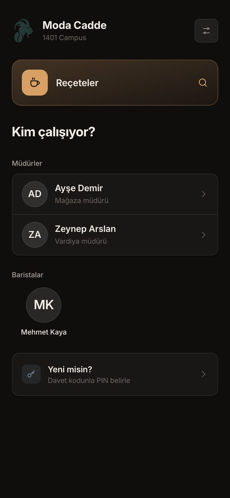<br/><sub>Mağaza telefonu: <b>Kim çalışıyor?</b></sub></td>
<td align="center">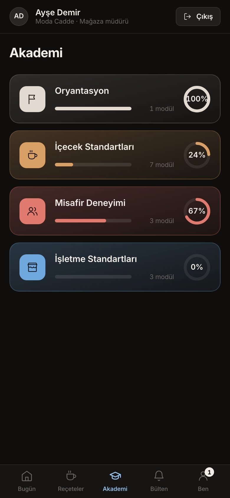<br/><sub><b>Akademi</b>: yollar ve modüller</sub></td>
<td align="center">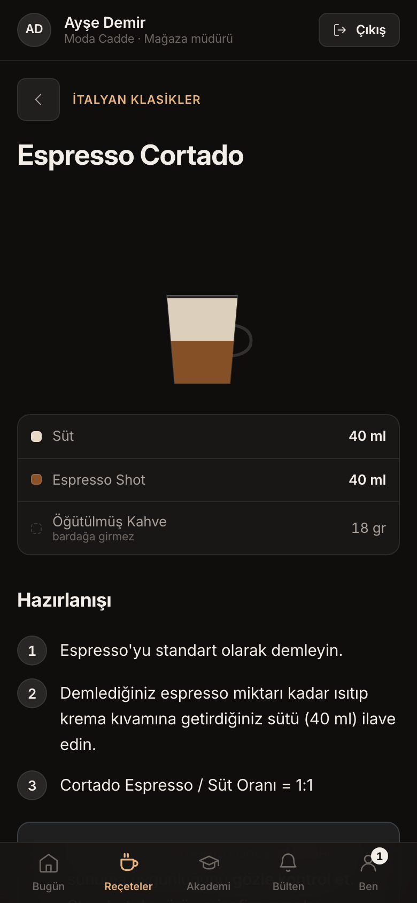<br/><sub><b>Reçete</b>: bardak şeması, ölçü, adım</sub></td>
<td align="center">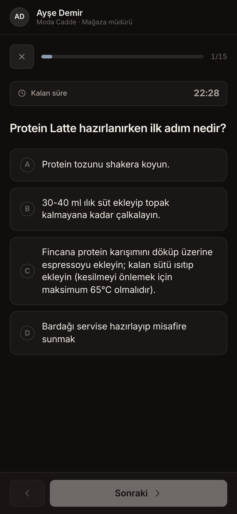<br/><sub><b>Sınav</b>: süreli, karışık şıklar</sub></td>
</tr>
<tr>
<td align="center">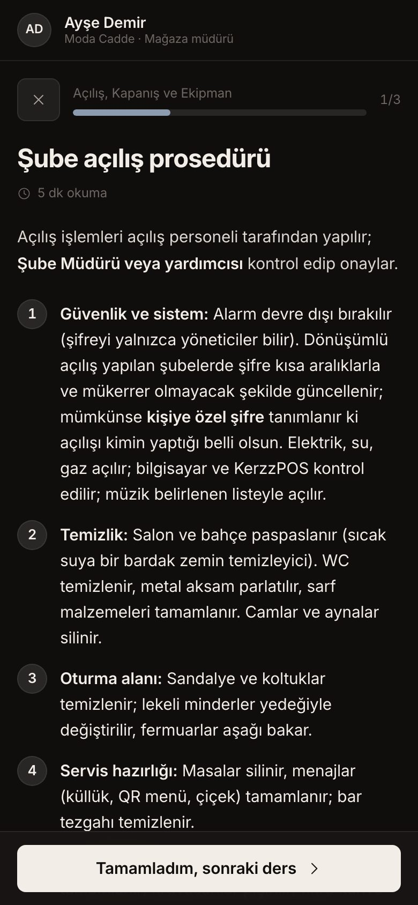<br/><sub><b>Ders</b>: standartlar adım adım</sub></td>
<td align="center">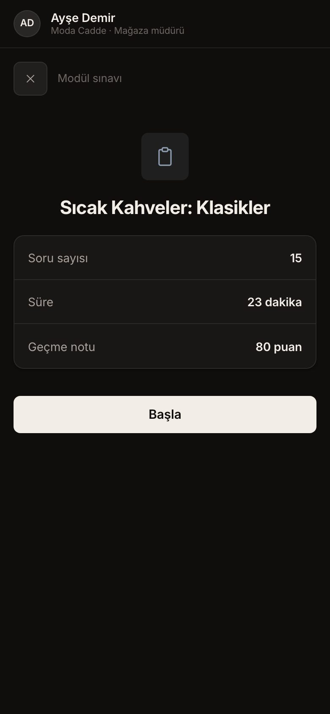<br/><sub>Sınav girişi ve haftalık hak</sub></td>
<td align="center">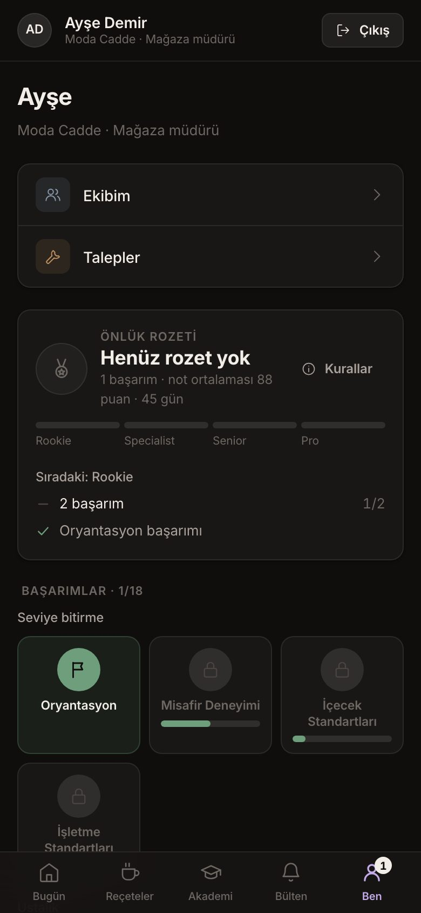<br/><sub><b>Sonuçlarım</b> ve yanlışlar</sub></td>
<td align="center">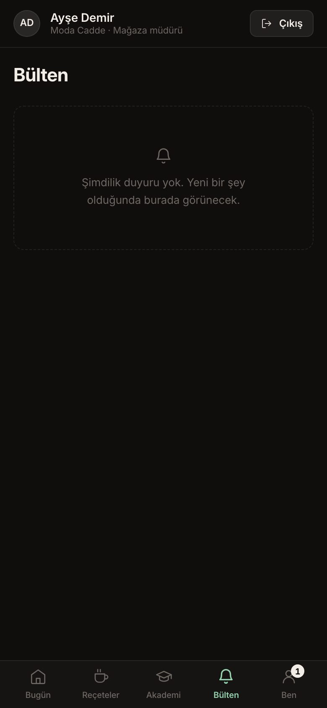<br/><sub><b>Bülten</b>: duyuru, kampanya</sub></td>
</tr>
</table>

- **Mağaza telefonu bir kez eşleşir.** Kahve Operasyonu 6 haneli kodu verir; sonra baristalar adına dokunup 4 haneli PIN'le girer.
- **Reçeteler PIN'siz açılır.** Bar başında hızlı bakmak için.
- **Sınav telefonda puanlanır.** Sonuç ve yanlışların açıklaması anında gelir. Haftalık deneme hakkı sınırlıdır.
- **Rozetler ve başarımlar:** Espresso Ustası, Tam Puan, Seri, Kitap Kurdu, Sözünün Eri gibi 18 başarım. Önlük rozetleri fiziksel olarak da teslim edilir.
- **Bağlantı koparsa** dersler önbellekten açılır. Sınav cevapları ve talepler telefonda bekler, bağlantı gelince gider.

## Panelde

<table>
<tr>
<td align="center">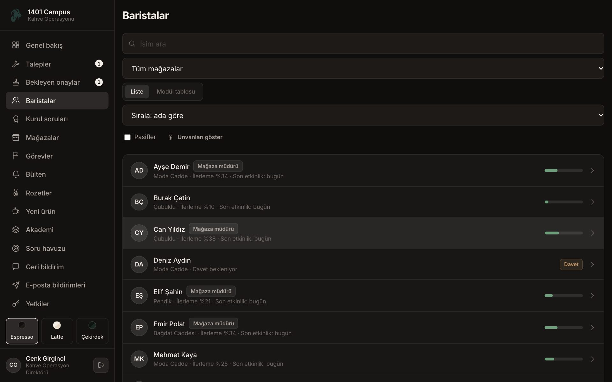<br/><sub><b>Baristalar</b>: ilerleme, sınav geçmişi, PIN ve davet</sub></td>
<td align="center">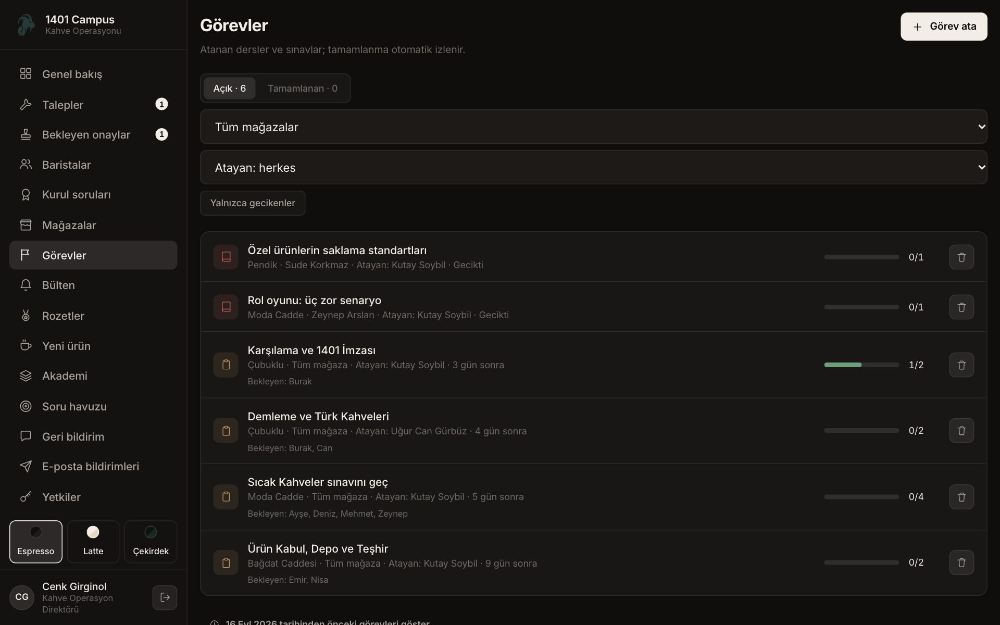<br/><sub><b>Görevler</b>: mağazaya ya da kişiye, son tarihli</sub></td>
</tr>
<tr>
<td align="center">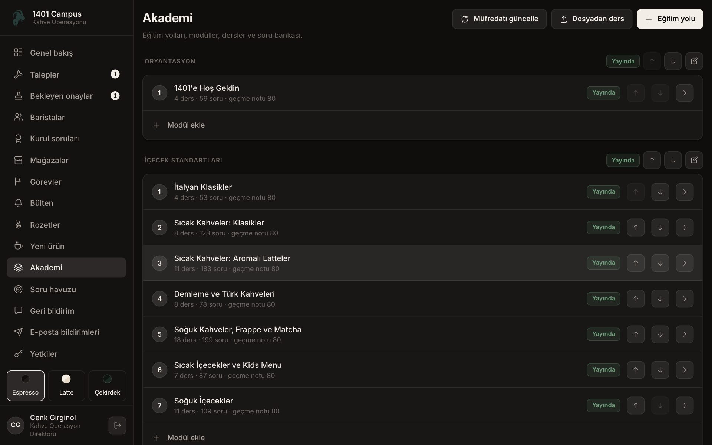<br/><sub><b>Akademi</b>: ders, modül, soru düzenleme; dosyadan ders</sub></td>
<td align="center">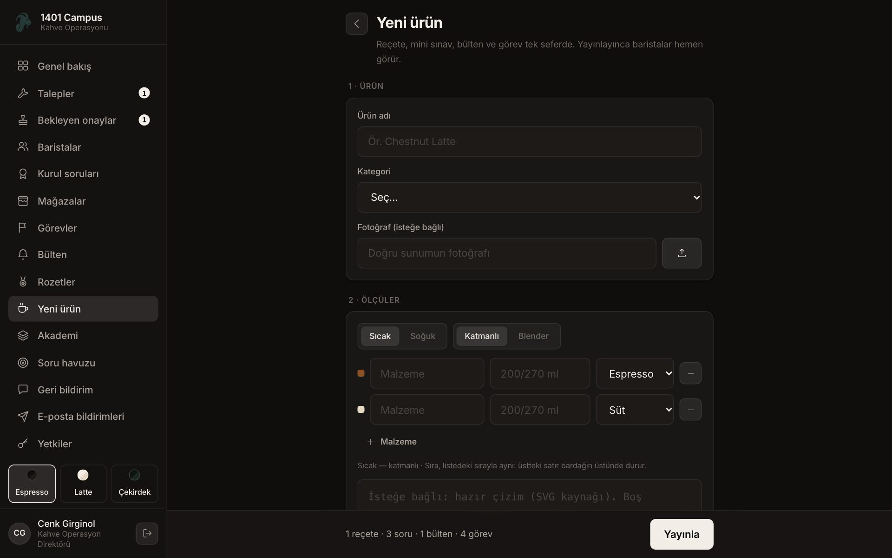<br/><sub><b>Yeni ürün</b>: reçete + mini sınav + bülten + görev tek seferde</sub></td>
</tr>
<tr>
<td align="center">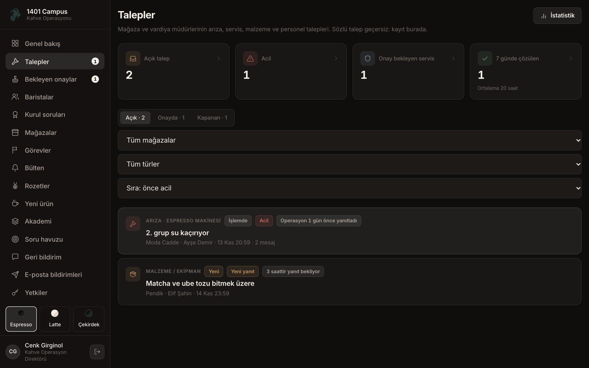<br/><sub><b>Talepler</b>: arıza, servis onayı, malzeme, istatistik</sub></td>
<td align="center">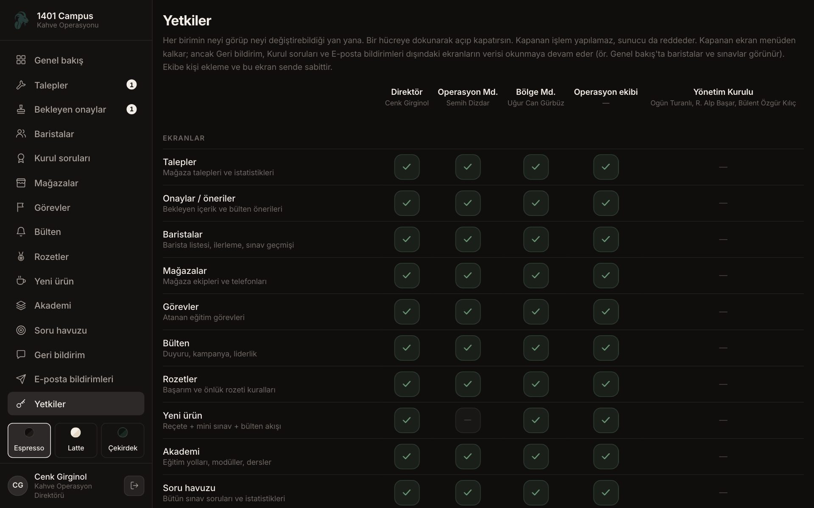<br/><sub><b>Yetkiler</b>: her rolün ekran ve işlemleri</sub></td>
</tr>
</table>

- **Yeni ürün akışı:** Reçeteyi gir. Uygulama mini sınavı kendisi üretir, bülteni yazar ve aktif baristası olan her şubeye görev açar.
- **Dosyadan ders:** PDF'i sürükle. Bölümlerinden 1-4 dakikalık dersler çıkar (yapay zekâ anahtarı girilirse daha iyi okur).
- **Onay akışı:** Bölge Müdürü ve ekip içeriği öneri olarak gönderir, Direktör yayınlar. Ders o arada değiştiyse uyarılır.
- **Soru havuzu:** Hatalı soruyu iptal et, geçmiş sınavlar yeniden puanlanır. Kimsenin puanı düşmez.
- **Yönetim Kurulu ekranı:** Mağaza karnesi, dönem karşılaştırması, süren işler, Excel raporu.
- **Geri bildirim ve hata kaydı:** Herkes uygulamanın içinden yazar. Çöken ekranlar otomatik kaydedilir.

## Nasıl çalışır

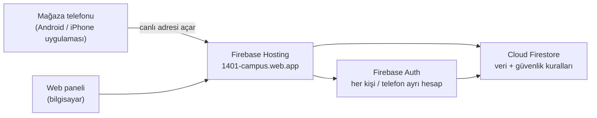

- **Sunucu yok.** Firebase'in ücretsiz Spark planı. Bütün iş telefonda ve tarayıcıda yapılır, yetkiyi `firestore.rules` zorlar.
- **Uygulama kabuğu canlı adresi açar.** Yeni bir sürüm `firebase deploy` ile yayınlanır ve telefonlara uygulamayı yeniden kurmadan ulaşır.
- **İçerik kodda yaşar.** Dersler, reçeteler ve sorular `scripts/` altındaki kaynaklardan derlenir (`src/generated/curriculum.json`). Canlıya panelden **Akademi → Müfredatı güncelle** ile yüklenir. Panelde eklenen dersler ve sorular bu güncellemede korunur.
- **İki ortam:** canlı (`playbook-1401`) ve demo (`playbook-demo-1401`). Kod aynı, veri ayrı. Demoya girilen kayıt canlıya geçmez.

### Güvenlik ve gizlilik

- Her telefon, barista ve yönetici ayrı bir Firebase hesabıdır. Rolü `users/{uid}` belgesinde durur.
- **Pasif hesap hiçbir şey okuyamaz ve yazamaz.** İşten ayrılan barista, bağlantısı kaldırılan telefon ve ekipten çıkarılan yönetici bu kapsamdadır. Açık oturum da kapanır.
- Yetkiler rol bazında Yetkiler ekranından ayarlanır. Aynı sınırı sunucu kuralları da uygular; arayüz ile kurallar birlikte değişir.
- Kapalı talebe yazılamaz; yeni konu için yeni talep açılır.

### Kalite

- **Yük testi** (`scripts/yuk-testi/`): yerel emülatörde 12 şube, 76 barista ve tam ekip aynı anda çalışır. Şunlar sınanır:
  - aynı anda sınav, iki cihazdan başlama;
  - sınav sürerken müfredat güncellemesi, soru iptali;
  - yetki kapatma, ağ kesintisi;
  - panel sayılarının doğruluğu ve günlük okuma kotası.
- **Son doğrulama:** 27 madde ve 206 kural denetimi geçti. Yoğun anda sınav başlatma 4,5 sn, teslim 3,4 sn (en yavaş %5).
- **Günlük okuma tahmini:** 12 şube / 76 barista için 29-40 bin. Spark sınırı 50 bin. Zamanla büyümez.

---

## Geliştirici notları

### Yerel geliştirme (emülatör)

Gerekenler: Node 22+, Java 21, `firebase-tools`. Bu Mac'te araçlar `~/.local` altında; bkz. `~/Desktop/Projects/CLAUDE.md`.

```bash
npm install
npx firebase emulators:start --only auth,firestore --project demo-playbook   # ayrı terminalde
npm run seed:emu         # müfredat + örnek mağaza, barista ve test hesapları
npm run dev:emu          # http://localhost:5173
```

`npm run emulators` `.emulator-data`'yı içe alır ve çıkışta üzerine yazar; deneme verisi kalıcı olsun istemiyorsan yukarıdaki komutu kullan. Test hesapları `scripts/seed.mjs` içindeki `TEST` nesnesindedir (yalnızca emülatör ve demo).

### Sık kullanılan komutlar

| Komut | Ne yapar |
|---|---|
| `npm run durum` | Canlı, demo, GitHub `master` ve bu bilgisayar aynı kodda mı (dört ✓) |
| `npm run deploy:demo` | Demoya dağıtır, sonra `www/`'yu canlı derlemeye döndürür |
| `npm run build` + `firebase deploy --only hosting,firestore --project playbook-1401` | Canlıya dağıtım |
| `npm run geri-bildirim -- --gun 1` | Canlıdaki geri bildirim ve hata kayıtlarını rapor dosyasına yazar |
| `npm run apk` | Android uygulaması → `apk/1401-campus-<sürüm>.apk` (canlı adresi açar) |
| `npm run iphone` | Kabloyla bağlı iPhone'a kurar (ücretsiz Apple hesabında 7 günde bir) |
| `npm run curriculum` | Müfredatı derler ve denetler (soru ve şık denetimleri dahil) |

Ayrıntılı adımlar: [CANLI.md](CANLI.md) (günlük kullanım) ve [YAYIN-GUNU.md](YAYIN-GUNU.md) (yayının kaydı).

### Yapı

```
shared/types.ts               Veri modeli (Firestore koleksiyonları)
firestore.rules               Rol ve etkinlik bazlı erişim; roles.ts ve permissions.ts ile birlikte değişir
src/api/                      Hesap, eşleştirme, PIN, davet (backend.ts) · sınav (exam.ts) · yeniden puanlama
                              (regrade.ts) · öneri ve onay (changes.ts) · müfredat yükleme (publishCurriculum.ts)
src/lib/                      Roller ve yetkiler · rozetler ve başarımlar · ilerleme · PDF'ten ders · arama
src/features/device           Telefon eşleştirme, "Kim çalışıyor?", PIN, davet, ilk kurulum
src/features/barista          Bugün, Akademi, ders, reçete, sınav, sonuçlar, bülten, ekibim, talepler
src/features/staff            Panel: genel bakış, baristalar, mağazalar, görevler, talepler, akademi,
                              yeni ürün, rozetler, soru havuzu, yetkiler, geri bildirim
src/features/board            Yönetim Kurulu ekranları ve raporlar
scripts/content.mjs           Müfredat kaynağı (İşletme Manueli, eğitim konuları, 2026 reçeteleri)
scripts/build-curriculum.mjs  Müfredatı src/generated/curriculum.json'a yazar
scripts/seed.mjs              Emülatöre / demoya örnek veri; canlıya yalnızca müfredat
scripts/yuk-testi/            Yük ve doğrulama betikleri (emülatörde)
scripts/durum.mjs             npm run durum
blaze/                        Blaze planına geçiş için saklanan sunucu kodu (kullanılmıyor)
```

### Spark planının sınırları

- **Günde 50.000 Firestore okuması.** Panel sayıları toplama sorgularıyla gelir, kurul dönemleri tek seferlik okunur, sınav soru havuzu telefon önbelleğinden gelir. Kullanımı `npm run durum` çıktısının sonundaki bağlantıdan izle.
- **Puanlama telefonda yapılır.** Cevap anahtarı etkin barista oturumlarına açıktır; sunucu tarafı doğrulama ancak Blaze'de mümkün (`blaze/README.md`).
- **Dosya deposu (Storage) yok.** Ders fotoğrafları küçültülüp (≈150 KB) ders belgesine gömülür. Video yalnızca dış bağlantıdır.
- **APK, Hosting'e konamıyor** (`Executable files are forbidden`). Şubelere mesajla gönderilir. Kurulum yönergesi `/indir/` adresindedir.
- **E-posta şablonları düzenlenemiyor.** Firebase bu projede kapatmış. E-postalardaki uygulama adı proje adından ("1401 Campus") gelir.

### Android imzalama

`android/keystore.properties` ve `android/1401-playbook.keystore` depoya **girmez**. Bu iki dosya kaybolursa aynı uygulamanın güncellemesi yayınlanamaz. Yedek: **OneDrive → `1401 Playbook Yedek/android-imzalama`**. Yeni bilgisayarda iki dosyayı `android/` içine kopyalayıp `storeFile` yolunu düzeltmek yeterli.

### Önbellek başlıkları

`firebase.json`: `index.html`, `/surum.json` ve `/indir/` için `no-cache`; `/assets/**` için bir yıl `immutable`. Giriş sayfası önbellekte kalırsa, dağıtımdan sonra telefon artık olmayan bir JS dosyasını ister ve sessiz boş ekran görür. Bu başlıkları kaldırma.

### Sezon güncellemesi (menü değişince)

1. `node scripts/extract-2026.mjs "<menü html>"` ile reçeteleri çıkar.
2. `scripts/content.mjs` içindeki `CATEGORY_MODULES` eşlemesini gözden geçir.
3. `npm run curriculum`, sonra demoya ve canlıya dağıt.
4. Panelde **Akademi → Müfredatı güncelle** → silinecekler listesini oku → **Uygula**.
