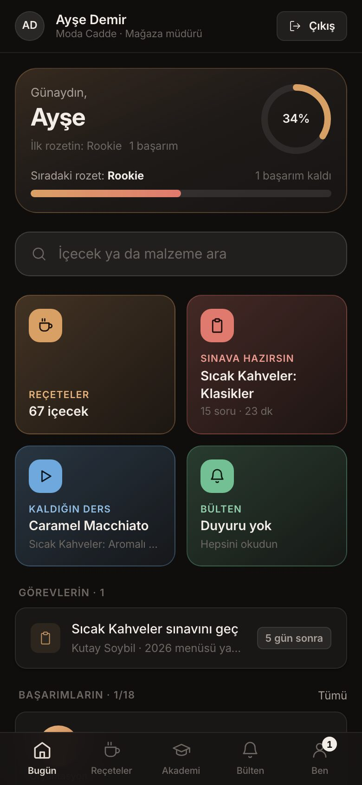
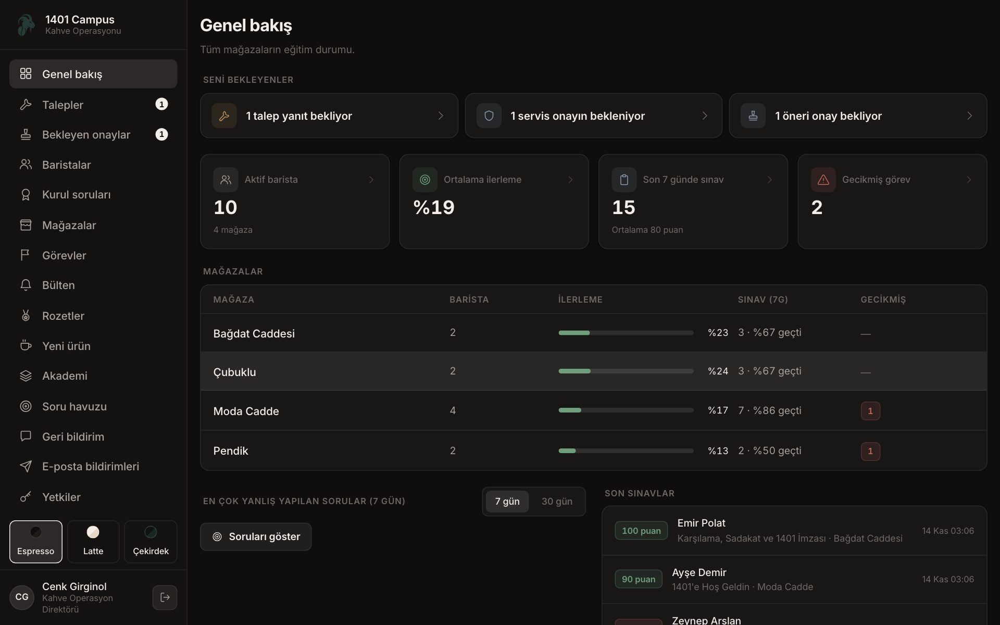
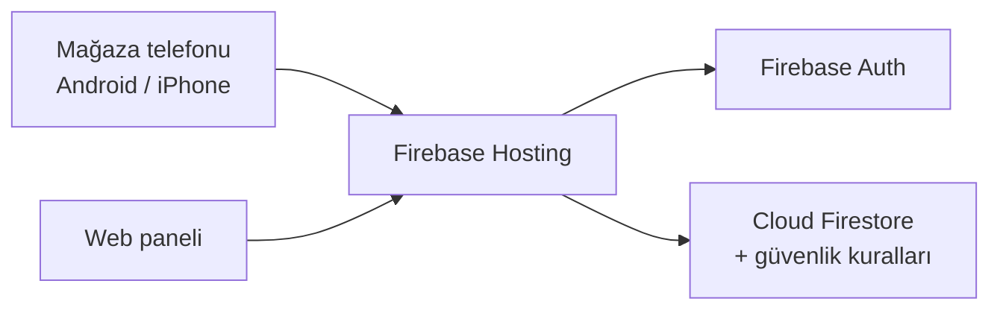

# 1401 Campus

1401 Coffee'nin eğitim uygulaması. Baristalar reçeteleri ve işletme standartlarını telefondan öğrenir, sınava girer, önlük rozeti kazanır. Kahve Operasyonu ekibi aynı sistemi web panelinden yönetir, Yönetim Kurulu gidişatı izler.

[Canlı](https://1401-campus.web.app) · [Demo](https://playbook-demo-1401.web.app) · [Kurulum yönergesi](https://1401-campus.web.app/indir/) · Sürüm 1.3

<p align="center">
  
  &nbsp;
  
</p>

## Kim, ne yapar

| | |
|---|---|
| **Barista** | Mağaza telefonunda ders okur, reçeteye bakar, süreli sınava girer, başarım ve rozet kazanır. |
| **Mağaza ve vardiya müdürü** | Ekibinin ilerlemesini izler, görev atar, Kahve Operasyonu'na talep açar. |
| **Kahve Operasyonu** | Direktör, operasyon müdürü ve bölge müdürü. İçerik yazar ve onaylar, mağaza ve baristaları yönetir, bülten yayınlar, talepleri yanıtlar. |
| **Yönetim Kurulu** | Mağaza karnelerini, süren işleri ve raporları salt okunur izler. |

4 eğitim yolu, 96 ders, 67 reçete ve 1.334 soruluk bir soru bankası. İçerik, şirketin işletme manuelinden ve sezon menüsünden derlenir.

## Mimari



Sunucu yok. Yetkiyi `firestore.rules` uygular; her rolün sınırı kural testleriyle doğrulanır. Telefon uygulaması canlı adresi açan bir kabuktur: yeni sürüm dağıtıldığında mağazalara yeniden kurulum gerekmeden ulaşır. Bağlantı koptuğunda dersler önbellekten açılır, sınav cevapları ve talepler bağlantı gelince gönderilir.

React 18 · TypeScript · Vite · Tailwind CSS · Firebase · Capacitor

## Geliştirme

```bash
npm install
npx firebase emulators:start --only auth,firestore --project demo-playbook
npm run seed:emu && npm run dev:emu
```

| Komut | |
|---|---|
| `npm run curriculum` | Müfredatı derler ve denetler |
| `npm run deploy:demo` | Demoya dağıtır |
| `node scripts/toplu-barista.mjs` | Listeden toplu barista ekler, süresi dolan davete yeni kod, mağaza telefonu kodları (önce kuru deneme; `--uygula` ile yazar) |
| `npm run durum` | Canlı, demo, GitHub ve yerel kopya aynı kodda mı |
| `npm run apk` | Android uygulamasını üretir |

Ayrıntılar: [mimari, güvenlik ve kalite](docs/MIMARI.md) · [canlı sistemin günlük kullanımı](CANLI.md)
