# Mimari, güvenlik ve kalite

Kısa tanıtım: [README](../README.md). Canlı sistemin günlük kullanımı: [CANLI.md](../CANLI.md).

## Ekranlar

<table>
<tr>
<td align="center">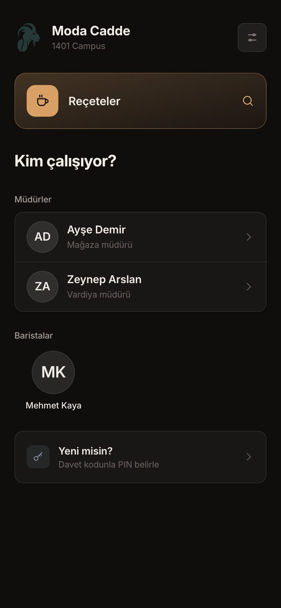<br/><sub>Kim çalışıyor?</sub></td>
<td align="center">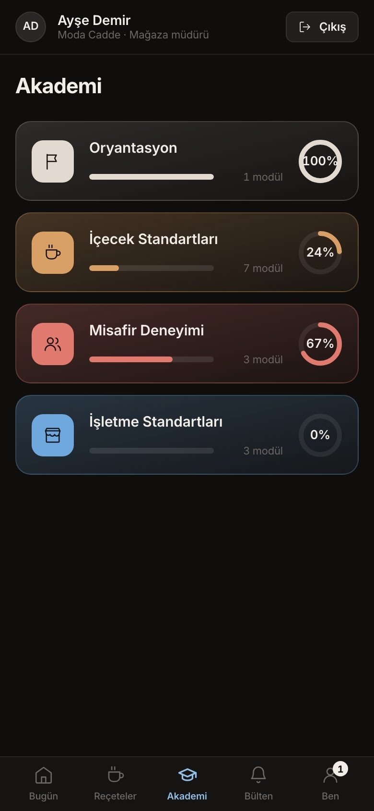<br/><sub>Akademi</sub></td>
<td align="center">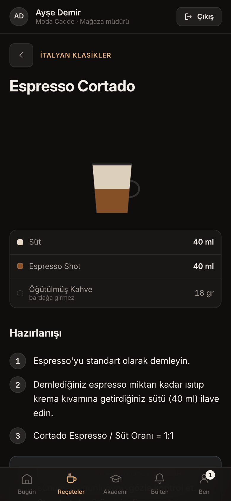<br/><sub>Reçete</sub></td>
<td align="center">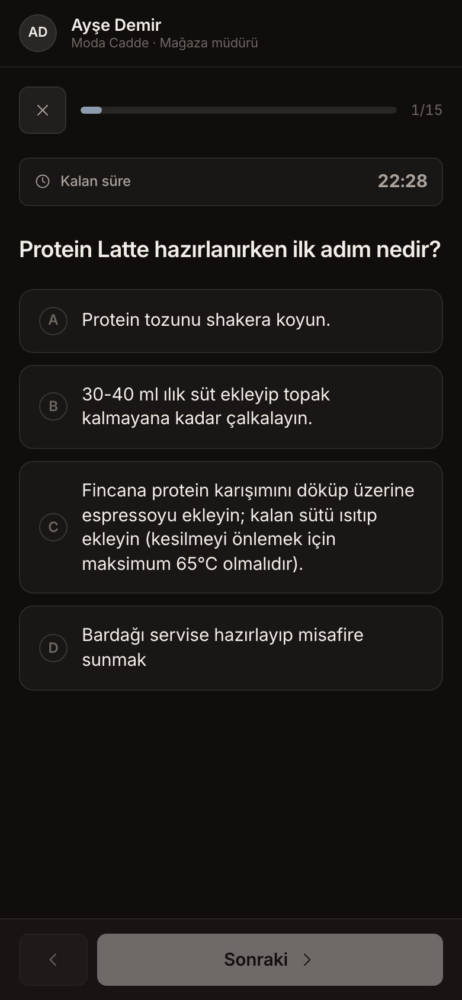<br/><sub>Sınav</sub></td>
</tr>
<tr>
<td align="center">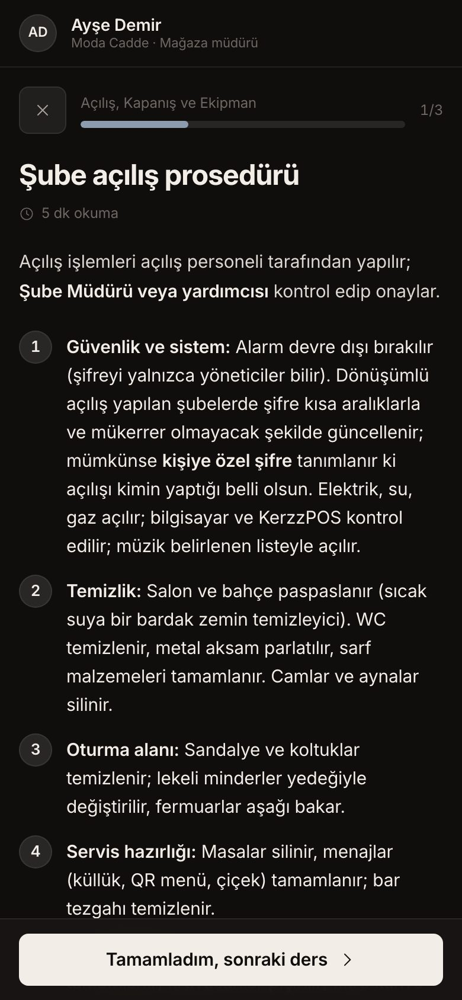<br/><sub>Ders</sub></td>
<td align="center">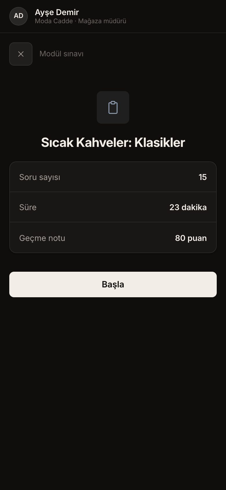<br/><sub>Sınav girişi</sub></td>
<td align="center">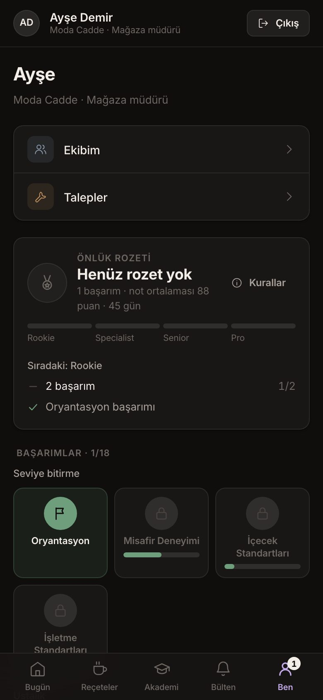<br/><sub>Sonuçlarım</sub></td>
<td align="center">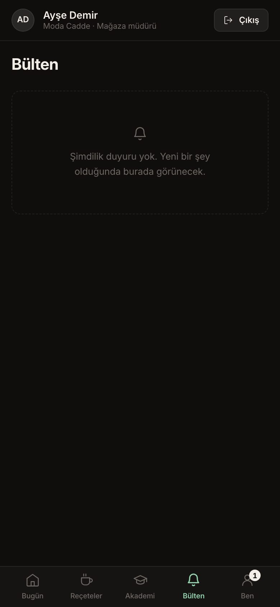<br/><sub>Bülten</sub></td>
</tr>
</table>

<table>
<tr>
<td align="center">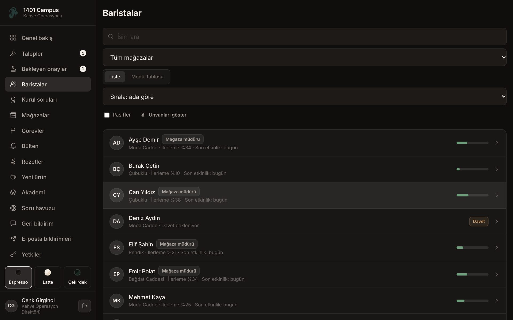<br/><sub>Baristalar</sub></td>
<td align="center">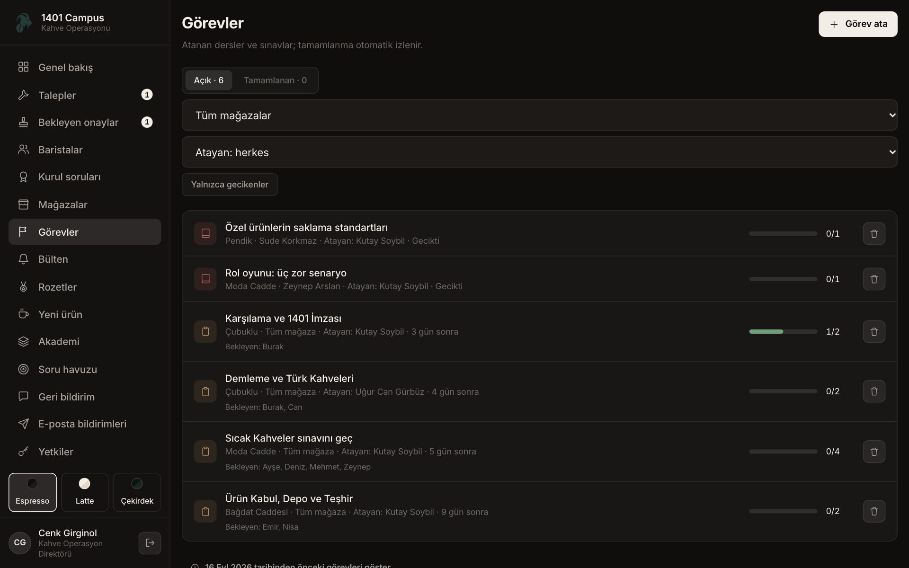<br/><sub>Görevler</sub></td>
</tr>
<tr>
<td align="center">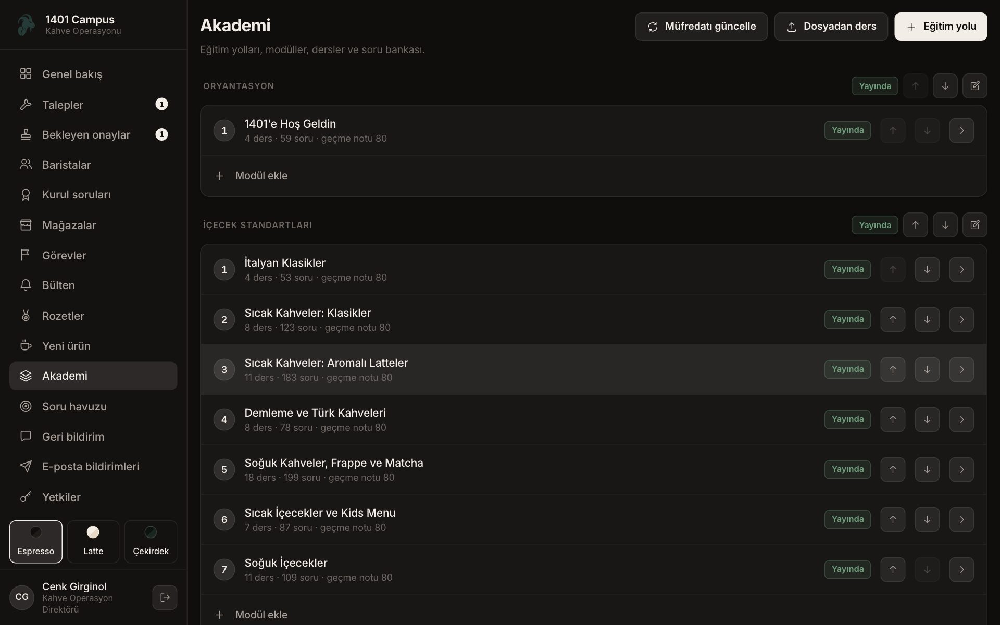<br/><sub>Akademi</sub></td>
<td align="center">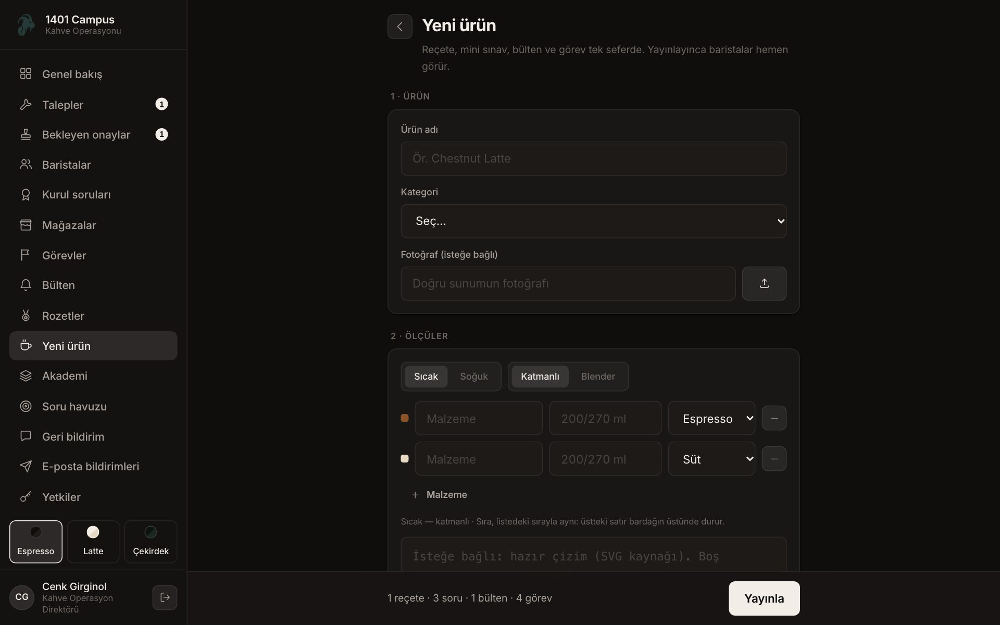<br/><sub>Yeni ürün</sub></td>
</tr>
<tr>
<td align="center">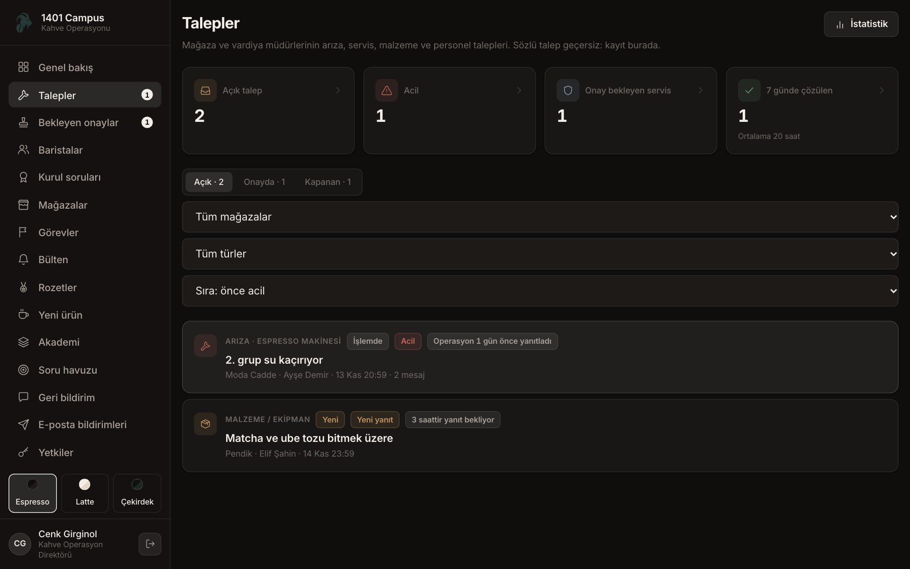<br/><sub>Talepler</sub></td>
<td align="center">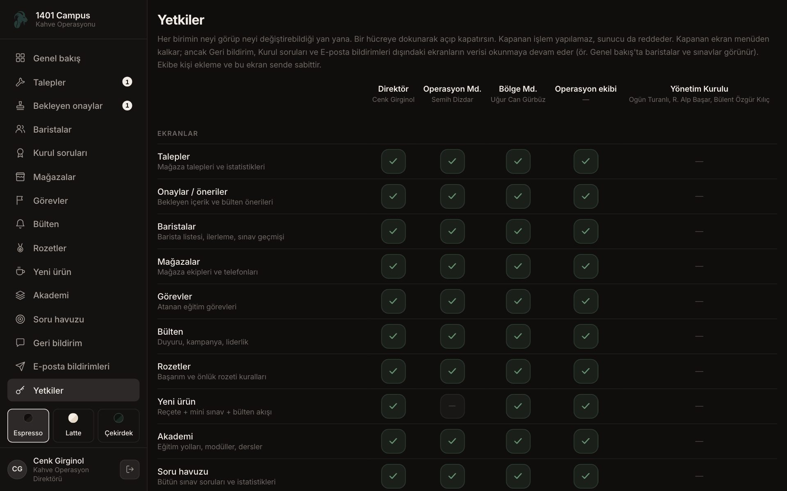<br/><sub>Yetkiler</sub></td>
</tr>
</table>

## Öne çıkan akışlar

- **Mağaza telefonu bir kez eşleşir.** Kahve Operasyonu 6 haneli kodu verir; baristalar adına dokunup 4 haneli PIN'le girer. Reçeteler PIN'siz açılır.
- **Sınav telefonda puanlanır.** Süreli, şıklar karışık, haftalık hak sınırlı. Hatalı soru iptal edilirse geçmiş sınavlar yeniden puanlanır; kimsenin puanı düşmez.
- **Yeni ürün:** Reçete girilir; uygulama mini sınavı üretir, bülteni yazar ve şubelere görev açar.
- **Dosyadan ders:** PDF'in bölümlerinden 1-4 dakikalık dersler çıkar.
- **Talep kapsamı dar.** Mağaza yalnızca üç konu açabilir: arıza, yetkili servis, ekipman ihtiyacı. Sarf malzeme/ürün siparişi, personel ve diğer konular uygulamada takip edilmiyor (satın almadan kimse yok); formda bunu söyleyen bir uyarı var. Kategoriler silinmedi, yalnızca seçilemez oldu — PIN sıfırlama talepleri `personel` kategorisini kullanmayı sürdürüyor (`src/api/requests.ts` MAGAZA_KATEGORILERI).
- **Onay akışı:** Bölge müdürünün içerik ve bülten değişiklikleri öneri olarak düşer, direktör yayınlar.
- **Yönetim Kurulu:** Mağaza karnesi, dönem karşılaştırması, süren işler, Excel raporu.

## Roller ve yetki

- Her telefon, barista ve yönetici ayrı bir Firebase hesabıdır; rolü `users/{uid}` belgesinde durur.
- Ekip rolleri: uygulama geliştiricisi, Kahve Operasyon Direktörü, Operasyon Müdürü, Bölge Müdürü, Yönetim Kurulu. Mağaza rolleri: mağaza müdürü, vardiya müdürü, barista.
- Rol tanımları `src/lib/roles.ts` ve `src/lib/permissions.ts` içinde, aynı sınırlar `firestore.rules` içinde. Üçü birlikte değişir.
- Yetkiler rol bazında panelin Yetkiler ekranından ayarlanır; sunucu kuralları aynı ayarı okur.
- Pasif hesap hiçbir şey okuyamaz ve yazamaz; açık oturumu da kapanır.
- Yöneticiler şifrelerini panelden, mevcut şifreyle değiştirir.

## Kalite

- **Kural testi** (`scripts/yuk-testi/kurallar.mjs`): 235 denetim. Her rolün yapabildiği ve yapamadığı işler, pasif ve kaldırılmış hesaplar.
- **Yük testi** (`scripts/yuk-testi/`): Yerel emülatörde 12 şube, 76 barista ve tam ekip aynı anda. Aynı anda sınav, iki cihazdan başlama, sınav sürerken müfredat güncellemesi, yetki kapatma, ağ kesintisi.
- **Çevrimdışı testi** (`scripts/cevrimdisi-test.mjs`): 17.11.2026 · 10 adım, 8 geçti. İnternetsiz: uygulama açılıyor, "Kim çalışıyor?" geliyor, reçete listesi ve ölçüler okunuyor, açık barista oturumu sürüyor, dersler okunuyor. Çalışmayan ikisi tasarım gereği: PIN ile **yeni** giriş (Auth gerekir — anlaşılır hata mesajı gösteriyor) ve sınava başlama.
- **Ölçümler:** Yoğun anda sınav başlatma 4,5 sn, teslim 3,4 sn (en yavaş %5). 12 şube için günlük okuma 29-40 bin; Spark sınırı 50 bin.
- **Hata kaydı:** Çöken ekranlar otomatik kaydedilir; geri bildirimler uygulamanın içinden gelir (`npm run geri-bildirim`).
- **Hız ölçümü:** Firebase Performance Monitoring (Spark'ta ücretsiz, kişi tutmaz). Hedefler ve ölçüm noktaları: [HIZ-BUTCESI.md](HIZ-BUTCESI.md).
- **Kullanım raporu:** `npm run kullanim` — kim kullanıyor, nerede takılıyor, neyi sadeleştirmeli ([KULLANIM-VERISI.md](KULLANIM-VERISI.md)).

## Kod yapısı

```
shared/types.ts               Veri modeli (Firestore koleksiyonları)
firestore.rules               Rol ve etkinlik bazlı erişim
src/api/                      Hesap, eşleştirme, PIN, sınav, yeniden puanlama, öneri ve onay, müfredat yükleme
src/lib/                      Roller ve yetkiler, rozetler, ilerleme, PDF'ten ders, arama
src/lib/ekranlar.ts           Ekran yollarının adları ve sayaç kodları (demo kaydı + sayaç ortak)
src/lib/kullanimKaydi.ts      Mağaza düzeyinde kullanım sayacı (kişiye bağlı değil)
src/lib/perf.ts               Süre ölçümü → Performance Monitoring özel izleri
src/features/device           Telefon eşleştirme, "Kim çalışıyor?", PIN, davet
src/features/barista          Bugün, Akademi, ders, reçete, sınav, sonuçlar, bülten, ekibim, talepler
src/features/staff            Panel ekranları
src/features/board            Yönetim Kurulu ekranları ve raporlar
scripts/content.mjs           Müfredat kaynağı
scripts/build-curriculum.mjs  Müfredatı src/generated/curriculum.json'a yazar
scripts/seed.mjs              Emülatöre ve demoya örnek veri; canlıya yalnızca müfredat
scripts/kullanim.mjs         Canlı kullanım raporu (npm run kullanim; docs/KULLANIM-VERISI.md)
scripts/yuk-testi/            Kural, yük ve doğrulama betikleri
blaze/                        Blaze planına geçiş için saklanan sunucu kodu (kullanılmıyor)
```

## Ortamlar

- **Canlı** (`playbook-1401`, https://1401-campus.web.app) ve **demo** (`playbook-demo-1401`). Kod aynı, veri ayrı.
- İçerik kodda yaşar ve panelden **Akademi → Müfredatı güncelle** ile canlıya yüklenir. Panelde eklenen dersler ve sorular korunur.
- Emülatörü `npm run emulators` ile açma: `.emulator-data`'yı içe alır ve çıkışta üzerine yazar. Test hesapları `scripts/seed.mjs` içindeki `TEST` nesnesindedir (yalnızca emülatör ve demo).

## Spark planının sınırları

- **Günde 50.000 Firestore okuması.** Panel sayıları toplama sorgularıyla, kurul dönemleri tek seferlik okunur; soru havuzu telefon önbelleğinden gelir.
- **Puanlama telefonda.** Sunucu tarafı doğrulama ancak Blaze'de mümkün (`blaze/README.md`).
- **Storage yok.** Ders fotoğrafları ≈150 KB'a küçültülüp ders belgesine gömülür; video yalnızca dış bağlantıdır.
- **APK Hosting'e konamaz.** Şubelere mesajla gönderilir; kurulum yönergesi `/indir/` adresindedir.
- **E-posta şablonları düzenlenemez.** Gönderen adresi proje kimliğinden gelir (`noreply@playbook-1401.firebaseapp.com`).

## Bakım notları

**Android imzalama.** `android/keystore.properties` ve `android/1401-playbook.keystore` depoya girmez. Kaybolursa aynı uygulamanın güncellemesi yayınlanamaz. Yedek: OneDrive → `1401 Playbook Yedek/android-imzalama`.

**Önbellek başlıkları.** `firebase.json`: `index.html`, `/surum.json` ve `/indir/` için `no-cache`; `/assets/**` için bir yıl `immutable`. Giriş sayfası önbellekte kalırsa telefon artık olmayan bir JS dosyasını ister ve boş ekran görür. Bu başlıkları kaldırma.

**Sezon güncellemesi.**
1. `node scripts/extract-2026.mjs "<menü html>"` ile reçeteleri çıkar.
2. `scripts/content.mjs` içindeki `CATEGORY_MODULES` eşlemesini gözden geçir.
3. `npm run curriculum`, sonra demoya ve canlıya dağıt.
4. Panelde **Akademi → Müfredatı güncelle** → silinecekler listesini oku → **Uygula**.

Yayın gününün kaydı: [YAYIN-GUNU.md](YAYIN-GUNU.md).
